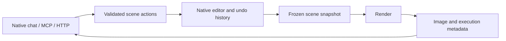

# Render LLM

A native 3D editor that an AI agent can operate, render and inspect. The agent gets
the rendered image back, so its next change can respond to the composition it
actually produced.


**Windows technical preview.** This repository is being prepared for external
testing. There is no supported public download yet. See [current status](docs/STATUS.md)
for the checks completed and the remaining release blockers.

<details>
<summary>See the native editor and an actual animation</summary>


[Download the original MP4](docs/media/studio-bounce.mp4). The still is 1280×720;
the animation is H.264, 384×216, 96 frames at 24 fps. Both were rendered by the
application with DXR and OIDN-CUDA; these are not generated mock screenshots.

</details>

## What it does

- Create and edit scenes with primitives, materials, lighting and cameras.
- Animate object properties with keyframes and a native timeline.
- Render stills, four-color variants, MP4 video and numbered PNG sequences.
- Control the same scene through native chat, **17 MCP tools** or a local HTTP API.
- Undo agent edits through the editor's history. Reject stale edits before they
  overwrite a newer scene revision.

The scene is a versioned `.renderllm` JSON document. Rendering uses a frozen
snapshot: changing the editor after a job starts does not alter that job's input.
Tools accept scene actions rather than shell commands or arbitrary output paths.



## Start with the tests

The agent and transport regression suite runs without a GPU, provider credentials
or model calls. It includes simulated editor tests; passing it does not certify
the native renderer.

```sh
cd ASSISTANT
npm ci --ignore-scripts
npm test
npm run build:runtime
```

For the actual editor, follow the [Windows build guide](docs/BUILD.md). A real
render requires the native executable and its runtime resources. The native chat
provider also requires the user's own supported Codex installation and login;
credentials are never included in this repository or in scene files.

## Try a scene

[studio-bounce.renderllm](examples/studio-bounce.renderllm) contains a small animated
studio scene. Open it in the native editor, render a still, change its material,
and undo the change. [The walkthrough](docs/DEMO.md) explains how to repeat that
flow over MCP and HTTP.

## Read the implementation

| Area | Entry point |
| --- | --- |
| Canonical scene format and validation | [RenderLlmDocument](CppProject/Native/RenderLlmDocument.cpp) |
| Native action boundary | [Native sources](CppProject/Native/) |
| Revision-aware scene actions | [renderllm-actions.ts](ASSISTANT/src/renderllm-actions.ts) |
| MCP tools | [renderllm-tools.ts](ASSISTANT/src/renderllm-tools.ts) |
| Authenticated local HTTP API | [http-server.ts](ASSISTANT/src/http-server.ts) |
| Frozen renders and media jobs | [still.ts](ASSISTANT/src/still.ts), [media-jobs.ts](ASSISTANT/src/media-jobs.ts) |

## Rendering and origins

The current format names the D3D11 renderer **Flame** and the DXR path tracer
**UltraFlame**. Export results report the backend and denoiser that actually ran.
See the [format contract](docs/FORMAT.md) for compatibility with older scene files.

This implementation retains native code and resources from Mine-imator. It builds
from committed C++ without running GameMaker or the GML generator, but it is not
a wholly independent rewrite. The agent integration, shared scene actions and
native migration work are documented here without removing upstream attribution.
See [licensing and provenance](LICENSING.md) before redistributing code or binaries.

## Contribute

Use an [issue](https://github.com/adrienverhaert/render-llm/issues) for a reproducible bug or a focused proposal. Read
[CONTRIBUTING.md](CONTRIBUTING.md) for checks and pull request expectations, and
[SECURITY.md](SECURITY.md) for private vulnerability reporting.
