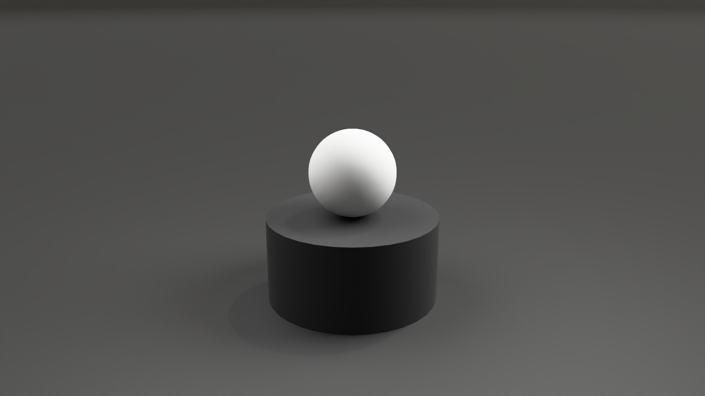
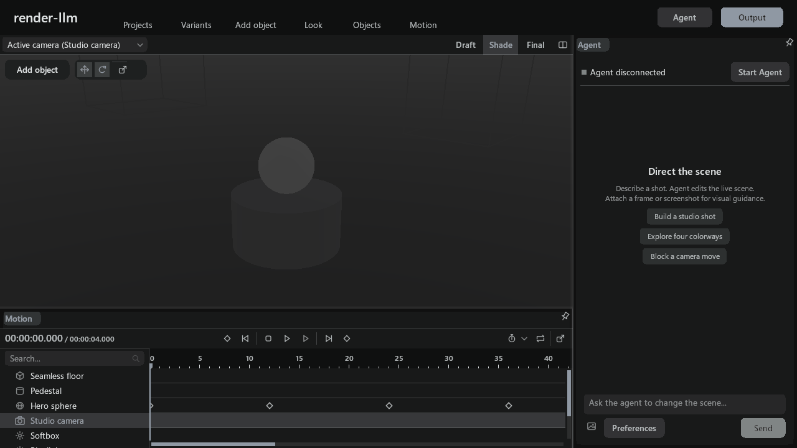
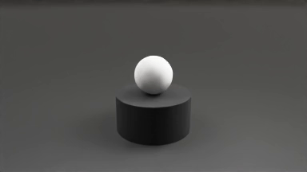
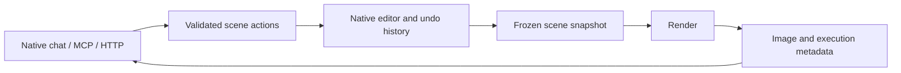

<div align="center">


# Render LLM

A native 3D editor with programmable scene control, GPU rendering and animation.
Create a scene in the editor or through MCP and HTTP, render it, and inspect the
result without leaving the same document.

[](https://github.com/adrienverhaert/render-llm/actions/workflows/ci.yml)
[](docs/BUILD.md)
[](ASSISTANT/package.json)
[](docs/STATUS.md)

**[Build](docs/BUILD.md) · [Try a scene](docs/DEMO.md) · [MCP & HTTP](docs/MCP.md) · [Verification](docs/STATUS.md)**



</div>

**Windows x64.** Follow the [build guide](docs/BUILD.md) to run the editor and the
[scene walkthrough](docs/DEMO.md) to try its rendering and transport interfaces.
[Packaged builds](docs/QUICKSTART.md) include a standalone quick start.
[Verification](docs/STATUS.md) records the tested build and export paths.

<details>
<summary>See the native editor and an actual animation</summary>





[Download the original MP4](docs/media/studio-bounce.mp4). The still is 1280×720;
the animation is H.264, 384×216, 96 frames at 24 fps. Both were rendered by the
application with DXR and OIDN-CUDA.

</details>

## What it does

- Create and edit scenes with primitives, materials, lighting and cameras.
- Animate object properties with keyframes and a native timeline.
- Render stills, four-color variants, MP4 video and numbered PNG sequences.
- Control the same scene through native chat, **17 MCP tools** or a local HTTP API.
- Undo agent edits through the editor's history. Reject stale edits before they
  overwrite a newer scene revision.

The scene is a versioned `.renderllm` JSON document. Rendering uses a frozen
snapshot: changing the editor after a job starts does not alter that job's input.
Tools accept scene actions rather than shell commands or arbitrary output paths.



## Start with the tests

The agent and transport regression suite runs without a GPU, provider credentials
or model calls. It includes simulated editor tests; passing it does not certify
the native renderer.

```sh
cd ASSISTANT
npm ci --ignore-scripts
npm test
npm run build:runtime
```

For the actual editor, follow the [Windows build guide](docs/BUILD.md). A real
render requires the native executable and its runtime resources. The native chat
provider also requires the user's own supported Codex installation and login;
credentials are never included in this repository or in scene files.

## Try a scene

[studio-bounce.renderllm](examples/studio-bounce.renderllm) contains a small animated
studio scene. Open it in the native editor, render a still, change its material,
and undo the change. [The walkthrough](docs/DEMO.md) explains how to repeat that
flow over MCP and HTTP.

## Read the implementation

| Area | Entry point |
| --- | --- |
| Canonical scene format and validation | [RenderLlmDocument](CppProject/Native/RenderLlmDocument.cpp) |
| Native action boundary | [Native sources](CppProject/Native/) |
| Revision-aware scene actions | [renderllm-actions.ts](ASSISTANT/src/renderllm-actions.ts) |
| MCP tools | [renderllm-tools.ts](ASSISTANT/src/renderllm-tools.ts) |
| Authenticated local HTTP API | [http-server.ts](ASSISTANT/src/http-server.ts) |
| Frozen renders and media jobs | [still.ts](ASSISTANT/src/still.ts), [media-jobs.ts](ASSISTANT/src/media-jobs.ts) |

```text
render-llm/
├── CppProject/    Native editor, scene bridge, Qt controls and rendering
├── ASSISTANT/     Agent, MCP/HTTP transports and protocol regression tests
├── examples/      Runnable studio and animation scenes
├── docs/          Contracts, build guide, walkthrough and recorded media
├── tools/         Pinned dependencies, build, packaging and verification
└── .github/       CI, preview packaging and contribution templates
```

## Verification and preview packages

CI builds the native Windows application, runs document checks, exercises the
agent suite on Windows and Linux, and checks tracked files and local documentation
links. The aggregate **Quality gate** requires every check to succeed.

The manual [Preview package workflow](.github/workflows/preview.yml) produces a
Windows ZIP from verified dependencies. It retains notices, verifies the staged
agent, extracts the archive and compares file hashes before uploading an artifact.
GPU execution is checked separately on actual hardware; hosted compilation does
not certify a GPU render. [Current status](docs/STATUS.md) records that distinction.

## Rendering

The current format names the D3D11 renderer **Flame** and the DXR path tracer
**UltraFlame**. Export results report the backend and denoiser that actually ran.
See the [format contract](docs/FORMAT.md) for compatibility with older scene files.

See [licensing and third-party notices](LICENSING.md) for the terms governing
source and binary redistribution.

## Contribute

Use an [issue](https://github.com/adrienverhaert/render-llm/issues) for a reproducible bug or a focused proposal. Read
[CONTRIBUTING.md](CONTRIBUTING.md) for checks and pull request expectations, and
[SECURITY.md](SECURITY.md) for private vulnerability reporting.
